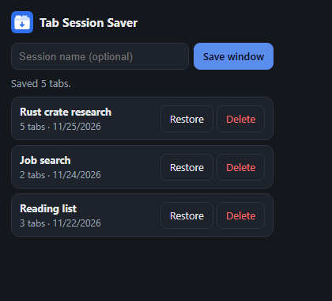

# Tab Session Saver

A small Chrome (Manifest V3) extension that saves the tabs of the current window as a named session and restores them later in a new window.




## Features

- Save all regular web pages (`http`/`https`) of the current window under a name (or an automatic timestamp name)
- Restore a session in a new window, keeping pinned tabs pinned
- Delete sessions; the newest 50 are kept
- Duplicate URLs are skipped, and internal pages (`chrome://`, `file://`) are not saved
- Everything stays on your machine in `chrome.storage.local`. No network access, no accounts

## Permissions

| Permission | Why |
|---|---|
| `tabs` | read the URLs and titles of the current window's tabs, open them again on restore |
| `storage` | keep saved sessions locally |

## Install (unpacked)

```bash
npm install
npm run build
```

Open `chrome://extensions`, enable Developer mode, choose **Load unpacked** and select the `dist/` folder.

## Development

```bash
npm run typecheck   # strict TypeScript
npm test            # unit tests for the session logic (Vitest)
npm run check       # typecheck + tests + build
```

## Structure

- `src/sessions.ts`: pure logic (filtering, deduplication, naming, limits, validation of stored data). No browser APIs, fully unit-tested
- `src/popup.ts`: the popup UI. It builds the DOM with `textContent` only, so page titles can never inject HTML
- `public/`: manifest, popup HTML and CSS
- `build.mjs`: esbuild bundle into `dist/`

## License

MIT
